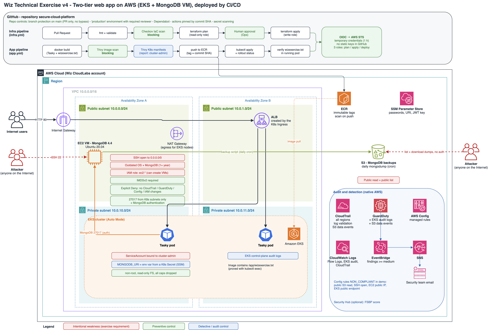

# Secure Cloud Platform : Wiz Technical Exercise v4 (AWS)

Une application web en deux couches sur AWS (**Tasky sur EKS** + **MongoDB sur une VM**), déployée
**uniquement** par des pipelines CI/CD. L'environnement contient des **faiblesses volontaires**
(exigées par l'exercice), et des **contrôles de sécurité natifs AWS** qui les détectent ou en limitent l'impact.



## L'environnement

| Bloc | Mise en oeuvre | Faiblesse volontaire |
|---|---|---|
| Application | Tasky (Go) reconstruite, image dans ECR, 2 pods sur **EKS Auto Mode** en subnets privés | Rôle **cluster-admin** sur tout le cluster |
| Exposition | Ingress Kubernetes, puis **ALB** AWS public | |
| Base de données | **MongoDB 4.4** sur **Ubuntu 20.04**, VM en subnet public, authentification obligatoire, port 27017 ouvert au réseau Kubernetes uniquement | OS et MongoDB obsolètes, **SSH ouvert à Internet**, rôle IAM **ec2:\*** (peut créer des VM) |
| Sauvegardes | `mongodump` quotidien (cron 02:00 UTC) vers S3 | Bucket **lisible et listable publiquement** |
| Secret applicatif | `MONGODB_URI` en variable d'environnement, via un Secret Kubernetes alimenté depuis SSM | |

## Les contrôles de sécurité

| Type | Contrôle | Ce qu'il montre en démo |
|---|---|---|
| **Audit** | **CloudTrail** multi-région (+ validation d'intégrité, + CloudWatch Logs), **data events** sur le bucket des sauvegardes, **logs d'audit EKS** | Qui a fait quoi, y compris qui a téléchargé un dump |
| **Préventif** | **Deny explicite** dans le rôle de la VM : impossible d'arrêter CloudTrail, GuardDuty, Config ou de toucher à IAM | `aws cloudtrail stop-logging` depuis la VM → `AccessDenied ... explicit deny` |
| **Préventif** | **IMDSv2 obligatoire** sur la VM | `curl` direct vers les métadonnées → `401` (vol d'identifiants par SSRF bloqué) |
| **Préventif** (pipeline) | **Checkov** bloquant sur le Terraform, **Trivy** bloquant sur l'image, branch protection, approbation humaine | Une erreur non justifiée ne peut pas être fusionnée |
| **Détectif** | **AWS Config** : règles managées | Bucket public, SSH ouvert, IP publique, API EKS publique : `NON_COMPLIANT` |
| **Détectif** | **GuardDuty** (+ audit EKS, + accès S3) → EventBridge → SNS → email | Tentatives SSH, appels API suspects |
| **Détectif** | **VPC Flow Logs** | Connexions refusées et acceptées sur la VM |
| **Détectif** (pipeline) | **Trivy** sur les manifestes Kubernetes (rapport) | Signale le binding cluster-admin (KSV-0111) |

Chaque faiblesse imposée est une exception **écrite dans le code** (`#checkov:skip=... INTENTIONNEL (exercice)`) :
toute autre erreur de configuration reste bloquée par la pipeline.

## Organisation du repo

```
bootstrap/              Lancé une fois en local : bucket du state, OIDC GitHub, 3 rôles IAM de la pipeline
infra/                  Infrastructure (Terraform), déployée uniquement par la pipeline
  network.tf            VPC, 2 subnets publics + 2 privés, NAT, flow logs
  eks.tf                Cluster EKS Auto Mode + accès kubectl (access entries)
  mongodb.tf            VM MongoDB + mots de passe dans SSM
  templates/            Script de premier démarrage de la VM (installation, utilisateurs, sauvegarde cron)
  backups.tf            Bucket public des sauvegardes
  cloudtrail.tf         Journal d'audit
  detection.tf          GuardDuty, AWS Config, Security Hub, alerte email
app/                    Tasky (Go) + Dockerfile + wizexercise.txt
k8s/                    Manifestes Kubernetes (namespace, RBAC, IngressClass, Deployment, Service, Ingress)
.github/workflows/
  infra.yml             PR : fmt, validate, Checkov, plan  |  main : apply après validation  |  manuel : destroy
  app.yml               PR : build + Trivy                 |  main : build, Trivy, push ECR, kubectl apply, vérifications
```

## Démarrer le lab (dans l'ordre)

### 0. Avant de commencer (le lab ne dure que 14 jours)

```bash
aws configure                      # avec les identifiants fournis par CloudLabs
aws sts get-caller-identity        # noter l'ID du compte et l'ARN de l'identité (pour kubectl)
aws configure get region           # vérifier la région autorisée par le lab
```

### 1. Bootstrap (une seule fois, en local)

```bash
cd bootstrap
cp terraform.tfvars.example terraform.tfvars   # ajuster la région si besoin
terraform init
terraform apply
```

Si le lab refuse la création du fournisseur OIDC ou des rôles IAM, c'est le plan B : clés du lab en secrets GitHub
(moins bien, à expliquer en démo comme une contrainte de l'environnement).

### 2. Variables du repo GitHub (Settings > Secrets and variables > Actions > Variables)

| Variable | Valeur |
|---|---|
| `AWS_ACCOUNT_ID`, `TF_STATE_BUCKET` | sorties du bootstrap |
| `AWS_REGION` | région du lab |
| `EKS_ADMIN_ARNS` | liste JSON, ex : `["arn:aws:iam::123456789012:user/odl_user"]` (résultat de `get-caller-identity`) |
| `SSH_PUBLIC_KEY` | contenu de `~/.ssh/<clé>.pub` (facultatif) |
| `ALERT_EMAIL` | **secret** (Settings > Secrets and variables > Actions > Secrets) : email qui reçoit les alertes GuardDuty. Secret et non variable, car le repo est public et le plan est publié dans la PR |

Si le compte a déjà GuardDuty, AWS Config ou Security Hub, passer `enable_guardduty` / `enable_config` / `enable_securityhub` à `false` dans `infra/variables.tf`.

### 3. Déploiement

1. Pull Request qui touche `infra/` : contrôles + plan en commentaire. Fusionner, puis approuver l'`apply` (~15 min, EKS est le plus long).
2. Lancer le workflow **Application** (Actions > Run workflow) : build, scan, push, déploiement, puis l'URL publique dans les logs.

## Démo : commandes clés

```bash
aws eks update-kubeconfig --region <region> --name scp-eks
alias k=kubectl

k get nodes -o wide                                    # noeuds en subnets privés (pas d'IP externe)
k get pods,svc,ingress -n tasky                        # l'application et son load balancer
k exec -n tasky deploy/tasky -- cat /app/wizexercise.txt
k get deploy tasky -n tasky -o jsonpath='{.spec.template.spec.containers[0].env}'   # MONGODB_URI depuis un Secret
k get clusterrolebinding tasky-cluster-admin -o wide   # la faiblesse volontaire
k auth can-i '*' '*' --as=system:serviceaccount:tasky:tasky   # "yes" : le pod est admin du cluster

# Prouver que les données sont dans la base (depuis la VM, via SSM ou SSH)
aws ssm start-session --target <mongodb_instance_id>
mongo -u admin -p "$(aws ssm get-parameter --name /scp/mongodb/admin-password --with-decryption --query Parameter.Value --output text)" \
  --authenticationDatabase admin go-mongodb --eval 'db.todos.find().pretty()'

# Sauvegarde : lancer à la main, puis la voir dans le bucket public
sudo /usr/local/bin/mongo-backup.sh
curl -s https://<bucket>.s3.<region>.amazonaws.com/ | head   # listing public, sans authentification

# Contrôles préventifs, depuis la VM
aws cloudtrail stop-logging --name scp-trail                 # AccessDenied (explicit deny)
curl -s -o /dev/null -w '%{http_code}\n' http://169.254.169.254/latest/meta-data/   # 401 : IMDSv2 obligatoire
```

## Coût et nettoyage

EKS (~0,10 $/h), noeuds Auto Mode, NAT Gateway, ALB, VM t3.small, Config et GuardDuty : quelques dollars par jour.
Après le panel : workflow **Infrastructure** > Run workflow > `destroy` (approbation requise), puis :

```bash
terraform -chdir=bootstrap destroy
```

## Crédits

Application : [Tasky](https://github.com/jeffthorne/tasky) (licence MIT), dépendances mises à jour et
bibliothèque JWT migrée vers `golang-jwt/jwt/v5` (CVE remontée par Trivy sur l'ancienne `dgrijalva/jwt-go`).
